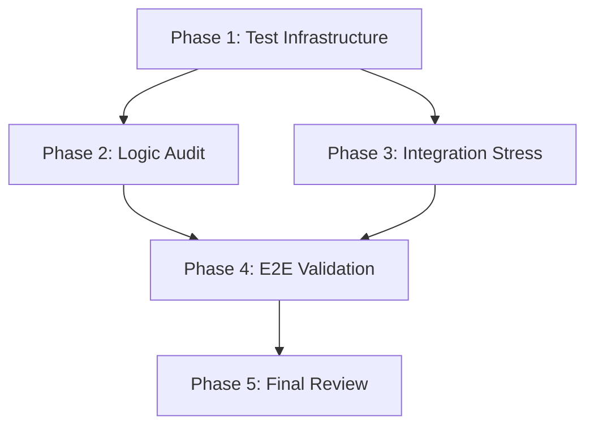

# Implementation Plan: Master-Report v5.2 Deep Verification

**Task Complexity**: complex
**Strategy**: Multi-layer verification (Unit -> Integration -> E2E) with complex dataset generation.

## Plan Overview
Total phases: 5
Agents: `tester`, `debugger`, `data_engineer`, `code_reviewer`
Estimated effort: High

## Dependency Graph

## Execution Strategy Table
| Stage | Phases | Agent(s) | Mode |
|-------|--------|----------|------|
| 1 | 1 | `tester` | Sequential |
| 2 | 2, 3 | `debugger`, `data_engineer` | Parallel |
| 3 | 4 | `tester` | Sequential |
| 4 | 5 | `code_reviewer` | Sequential |

## Phase Details

### Phase 1: Test Infrastructure Setup
**Objective**: Create a robust test generator capable of producing edge-case Excel files.
**Agent**: `tester`
**Files to Create**:
- `APP/tests/test_generator.py`: Script to generate .xlsx files with:
  - Headers at random row indices (0-100).
  - Merged cells and complex formatting.
  - Diverse numeric formats (scientific notation, comma/dot separators).
  - Junk rows (headers repeated, manual totals).
  - Different sheet names (matching and non-matching).

### Phase 2: Logic & Precision Audit
**Objective**: Verify core consolidator logic against complex datasets.
**Agent**: `debugger`
**Files to Create**:
- `APP/tests/logic_audit.py`: Unit tests for:
  - `Consolidator.to_decimal`: precision check on currency strings.
  - `Template1Reader.find_header_row`: sensitivity check on header detection.
  - `Consolidator.is_junk_row`: accuracy check on filtering logic.
**Validation**: `python APP/tests/logic_audit.py`

### Phase 3: Integration & Config Stress-Test
**Objective**: Test file discovery and configuration flexibility.
**Agent**: `data_engineer`
**Files to Create**:
- `APP/tests/integration_stress.py`: Tests for:
  - `Consolidator.get_employees`: verify deduplication (hash-based) and nested discovery.
  - `Config` reloading: verify system adapts to marker changes in `config.yaml`.
**Validation**: `python APP/tests/integration_stress.py`

### Phase 4: E2E Validation & Ground Truth
**Objective**: Run the complete flow and compare results with a pre-calculated Ground Truth.
**Agent**: `tester`
**Files to Create**:
- `APP/tests/full_e2e_verification.py`: 
  - Generates data with known totals.
  - Runs `Consolidate -> Write -> Audit`.
  - Verifies `Master_Report.xlsx` sheet totals and `DEEP_AUDIT_REPORT.txt` entries.
**Validation**: `python APP/tests/full_e2e_verification.py`

### Phase 5: Production Readiness & Final Review
**Objective**: Final security and reliability review of the optimized codebase.
**Agent**: `code_reviewer`
**Validation**: Final audit of `consolidator.py` and `writer.py`.

## File Inventory
| Phase | Action | Path | Purpose |
|-------|--------|------|---------|
| 1 | Create | `APP/tests/test_generator.py` | Data generator |
| 2 | Create | `APP/tests/logic_audit.py` | Unit verification |
| 3 | Create | `APP/tests/integration_stress.py` | Integration check |
| 4 | Create | `APP/tests/full_e2e_verification.py` | Full flow test |

## Execution Profile
- Total phases: 5
- Parallelizable phases: 2 (Phases 2 & 3)
- Estimated sequential wall time: ~15-20 mins
- Estimated parallel wall time: ~12-15 mins

| Phase | Agent | Model | Est. Input | Est. Output | Est. Cost |
|-------|-------|-------|-----------|------------|----------|
| 1 | `tester` | Pro | 8000 | 1500 | $0.14 |
| 2 | `debugger` | Pro | 12000 | 1000 | $0.16 |
| 3 | `data_engineer` | Pro | 10000 | 1000 | $0.14 |
| 4 | `tester` | Pro | 15000 | 1500 | $0.21 |
| 5 | `code_reviewer` | Pro | 20000 | 500 | $0.22 |
| **Total** | | | **65000** | **55000** | **$0.87** |
