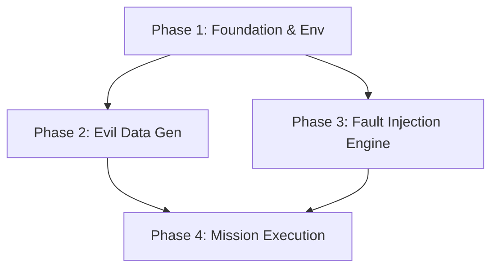

# Implementation Plan

## 1. Plan Overview
- **Total Phases**: 4
- **Agents Involved**: `debugger`, `coder`, `tester`
- **Estimated Effort**: Средняя (Сложные сценарии многопоточности)

## 2. Dependency Graph

## 3. Execution Strategy
| Stage | Phases | Agent | Mode |
|---|---|---|---|
| 1 | 1 | `coder` | Sequential |
| 2 | 2, 3 | `coder`, `debugger` | Parallel |
| 3 | 4 | `tester` | Sequential |

## 4. Phase Details

### Phase 1: Environment Orchestrator (Foundation)
- **Objective**: Подготовить изолированную среду для деструктивных тестов.
- **Agent**: `coder`
- **Files Created**: `destructive_tester_v5_5.py` (Skeleton & EnvManager).
- **Details**: 
    - Логика копирования текущего проекта в `temp_destructive_env/`.
    - Механизм динамического импорта классов (`AppController`, `SQLiteManager`) из временной директории.
    - Скрипт очистки (Cleanup) после тестов.
- **Validation**: Проверка успешного запуска пустого `AppController` из временной папки.

### Phase 2: Evil Data Generator (Missions 3 & 4)
- **Objective**: Написать генератор файлов с дефектами.
- **Agent**: `coder`
- **Files Modified**: `destructive_tester_v5_5.py` (Adding `EvilGenerator` class).
- **Details**: 
    - Создание функций для генерации `.xlsx` с: двойными шапками, скрытыми листами, датами "32.01", миллиардами (через `openpyxl`).
    - Генерация данных с комиссиями 0/100%.
- **Validation**: Проверка читаемости сгенерированных файлов стандартным Excel (визуально или через `read_file` метаданных).

### Phase 3: Fault Injection Engine (Missions 1 & 2)
- **Objective**: Внедрить "диверсионный" слой в классы приложения.
- **Agent**: `debugger`
- **Files Modified**: `destructive_tester_v5_5.py` (Adding `MonkeySaboteur` class).
- **Details**: 
    - Реализация патчинга `SQLiteManager._execute_with_retry`.
    - Реализация патчинга `IngestionEngine._read_xlsx` (внедрение `time.sleep`).
    - Подмена `os.replace` глобально в контексте `MasterWriter`.
- **Validation**: Проверка срабатывания искусственных задержек и ошибок через простые assert-ы.

### Phase 4: Mission Execution & Audit
- **Objective**: Запуск 4-х сценариев миссий и генерация отчета.
- **Agent**: `tester`
- **Files Modified**: `destructive_tester_v5_5.py` (Adding `MissionRunner` and Audit logic).
- **Details**: 
    - Оркестрация: запуск Миссий 1-4 последовательно.
    - Использование `multiprocessing` для теста "Kill Process".
    - Итоговый отчет в формате: `Mission Name | Status | Error (if failed)`.
- **Validation**: Соответствие итогов правилу "Hard Stop".

## 5. Execution Profile
- **Total phases**: 4
- **Parallelizable phases**: 2 (Phase 2 & 3)
- **Estimated Cost**: ~$0.15 - $0.25 (учитывая глубокий анализ сбоев).

Note: Native parallel execution currently runs agents in autonomous mode.
All tool calls are auto-approved without user confirmation.
