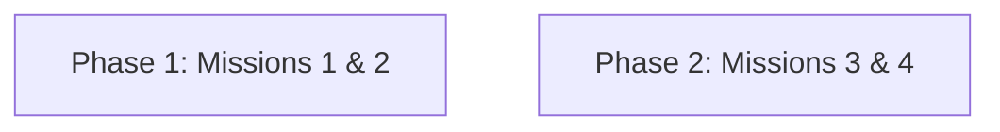

# Implementation Plan

## 1. Plan Overview
- **Total Phases**: 2
- **Agents Involved**: `tester`
- **Estimated Effort**: Низкая (Создание документации для мануального тестирования)

## 2. Dependency Graph

*Примечание: Фаза 1 и Фаза 2 независимы и могут выполняться параллельно.*

## 3. Execution Strategy
| Stage | Phases | Agent | Mode |
|---|---|---|---|
| 1 | 1, 2 | `tester` | Parallel-eligible |

## 4. Phase Details

### Phase 1: Environment & UI Stress Missions
- **Objective**: Сгенерировать подробные markdown чек-листы для миссий "Жонглер файлами" и "Хаотичный кликер".
- **Agent**: `tester`
- **Files Created**:
  - `docs/testing/Mission_1_File_Juggler.md`
  - `docs/testing/Mission_2_Chaotic_Clicker.md`
- **Details**: Написать детальные, пошаговые сценарии, имитирующие жесткие блокировки файлов (Excel locks) и агрессивные прерывания в GUI во время консолидации. Включить ожидаемые результаты согласно правилу "Hard Stop".
- **Validation**: Проверка корректности markdown и наличия чек-боксов `[ ]`.
- **Dependencies**: Нет.

### Phase 2: Data & Logic Corruption Missions
- **Objective**: Сгенерировать подробные markdown чек-листы для миссий "Злой бухгалтер" и "Математик-экстремал".
- **Agent**: `tester`
- **Files Created**:
  - `docs/testing/Mission_3_Evil_Accountant.md`
  - `docs/testing/Mission_4_Extreme_Math.md`
- **Details**: Написать шаги по созданию "ядовитых" входных данных: скрытые листы, даты вне диапазонов, двойные шапки, а также пограничные сценарии расчетов (комиссии 100%, возвраты).
- **Validation**: Проверка корректности markdown.
- **Dependencies**: Нет.

## 5. File Inventory
| File | Phase | Purpose |
|---|---|---|
| `docs/testing/Mission_1_File_Juggler.md` | 1 | Сценарий мануального тестирования |
| `docs/testing/Mission_2_Chaotic_Clicker.md` | 1 | Сценарий мануального тестирования |
| `docs/testing/Mission_3_Evil_Accountant.md` | 2 | Сценарий мануального тестирования |
| `docs/testing/Mission_4_Extreme_Math.md` | 2 | Сценарий мануального тестирования |

## 6. Execution Profile
- **Total phases**: 2
- **Parallelizable phases**: 2 (in 1 batch)
- **Sequential-only phases**: 0
- **Estimated Cost**: ~$0.05 (поскольку агенты будут только писать текст, без долгого кодинга).
