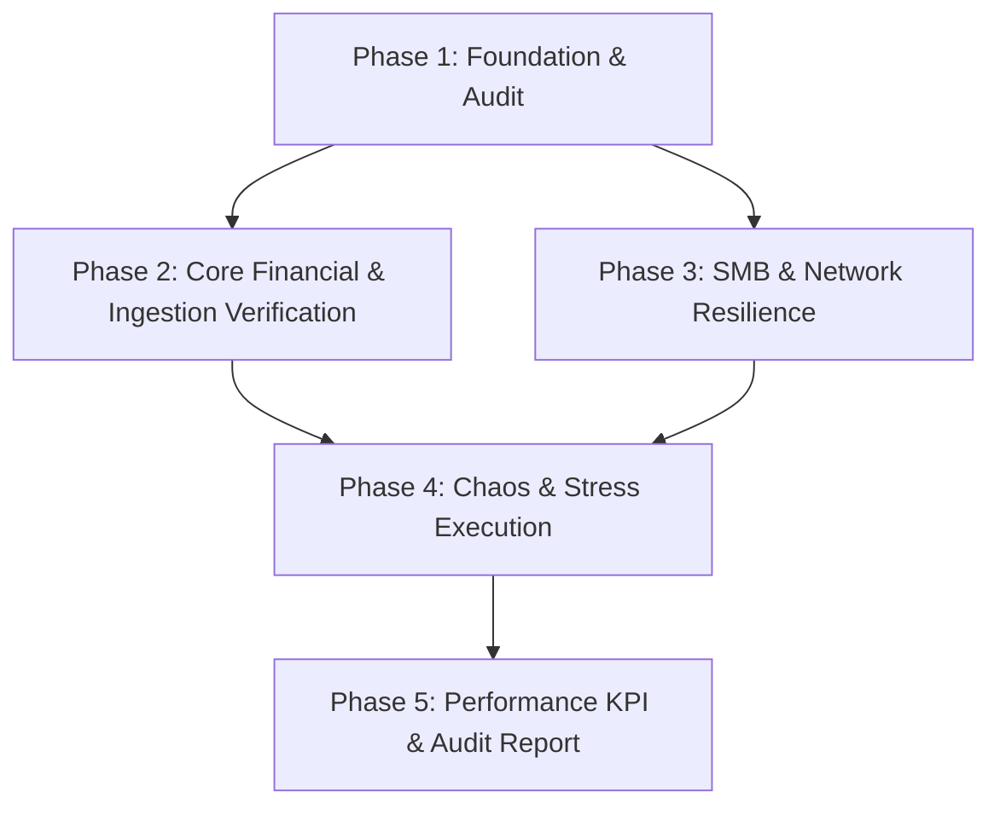

# Implementation Plan: Master-Report v5.5 "Elite" Comprehensive Testing

## 1. Plan Overview
Этот план реализует стратегию "Chaos & Stress Suite" для подтверждения статуса "Elite" версии 5.5. Мы проведем полную проверку системы от глубоких юнитов до нагрузочного хаоса.

## 2. Dependency Graph

## 3. Execution Strategy Table
| Phase | Agent | Mode | Parallel | Files Modified/Created |
|-------|-------|------|----------|------------------------|
| 1 | `code_reviewer` | Sequential | No | - |
| 2 | `tester` | Parallel | Yes | `tests/test_logic_service.py`, `tests/test_ingestion_manager.py` |
| 3 | `tester` | Parallel | Yes | `tests/test_network_chaos.py` |
| 4 | `performance_engineer` | Sequential | No | `tests/stress_test_new.py` |
| 5 | `technical_writer` | Sequential | No | `TESTING_REPORT_ELITE.md` |

## 4. Phase Details

### Phase 1: Foundation & Audit
- **Objective**: Архитектурный аудит "швов" и проверка готовности окружения.
- **Agent**: `code_reviewer`
- **Details**: Проверка `AppController` на предмет обработки исключений при параллельном IO. Анализ `requirements.txt` на наличие `psutil` для стресс-тестов.
- **Validation**: Прохождение базовых тестов инфраструктуры.

### Phase 2: Core Financial & Ingestion Verification
- **Objective**: 100% покрытие финансовой логики и парсинга.
- **Agent**: `tester`
- **Files to Modify**:
    - `tests/test_logic_service.py`: Добавление кейсов для `percent_broker > 1.0`, `ROUND_HALF_UP` и маршрутизации ПРИХОД/РАСХОД.
    - `tests/test_ingestion_manager.py`: Проверка очистки Unicode и детекции заголовков на 6000+ строках.
- **Validation**: `pytest tests/test_logic_service.py tests/test_ingestion_manager.py`

### Phase 3: SMB & Network Resilience
- **Objective**: Проверка стратегии "Local Copy" и поведения при обрывах.
- **Agent**: `tester`
- **Files to Create**:
    - `tests/test_network_chaos.py`: Тест на удаление файла во время копирования, имитация задержек `shutil.copy2`.
- **Validation**: `pytest tests/test_network_chaos.py`

### Phase 4: Chaos & Stress Execution
- **Objective**: Нагрузочное тестирование (100k+ строк) и хаос БД.
- **Agent**: `performance_engineer`
- **Files to Create**:
    - `tests/stress_test_new.py`: Генерация сверхбольших файлов и запуск 16+ потоков обработки для проверки SQLite WAL.
- **Validation**: `python tests/stress_test_new.py`

### Phase 5: Performance KPI & Audit Report
- **Objective**: Формирование финального отчета "Elite".
- **Agent**: `technical_writer`
- **Files to Create**:
    - `TESTING_REPORT_ELITE.md`: Сводная таблица KPI, результаты покрытия и подтверждение готовности к релизу.
- **Validation**: Проверка читаемости отчета.

## 5. File Inventory
| File Path | Phase | Purpose |
|-----------|-------|---------|
| `tests/test_logic_service.py` | 2 | Unit-тесты финансового ядра |
| `tests/test_ingestion_manager.py` | 2 | Интеграционные тесты парсинга |
| `tests/test_network_chaos.py` | 3 | Проверка сетевой устойчивости |
| `tests/stress_test_new.py` | 4 | Нагрузочный сценарий |
| `TESTING_REPORT_ELITE.md` | 5 | Финальный технический отчет |

## 6. Execution Profile
- **Total phases**: 5
- **Parallelizable phases**: 2 (Phase 2 & 3)
- **Estimated Cost**: ~$0.45 (Deep reasoning & multiple subagents)

Note: Native parallel execution will be used for Phase 2 & 3.
