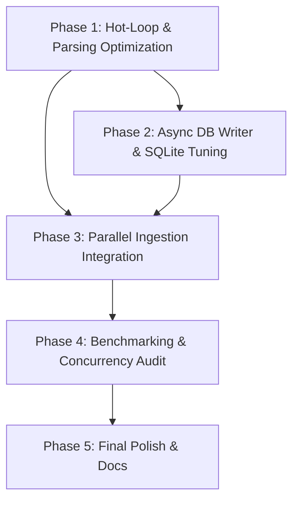

# Implementation Plan: Master-Report v5.5 "Elite" Performance Acceleration

## 1. Plan Overview
Этот план направлен на достижение экстремальной производительности Master-Report путем устранения архитектурных боттлнеков в IO и горячих циклах обработки данных. Мы перейдем к паттерну Producer-Consumer для записи в БД и оптимизируем парсинг строк.

## 2. Dependency Graph

## 3. Execution Strategy Table
| Phase | Agent | Mode | Parallel | Files Modified/Created |
|-------|-------|------|----------|------------------------|
| 1 | `performance_engineer` | Sequential | No | `APP/core/domain/utils_helpers.py`, `APP/core/infra/ingestion_readers.py` |
| 2 | `coder` | Parallel | Yes | `APP/core/infra/persistence_manager.py` |
| 3 | `coder` | Parallel | Yes | `APP/core/app_controller.py` |
| 4 | `tester` | Sequential | No | `tests/performance_benchmark.py` |
| 5 | `technical_writer` | Sequential | No | `docs/PERFORMANCE_GUIDE.md` |

## 4. Phase Details

### Phase 1: Hot-Loop & Parsing Optimization
- **Objective**: Замена медленного `re.sub` и Pydantic-валидации в циклах парсинга.
- **Agent**: `performance_engineer`
- **Files to Modify**:
    - `APP/core/domain/utils_helpers.py`: Оптимизация `to_decimal` через `str.translate` и кэширование regex.
    - `APP/core/infra/ingestion_readers.py`: Перенос очистки данных внутрь ридера и переход на `FinancialRowSchema.model_construct()`.
- **Validation**: `pytest tests/test_logic_service.py` (проверка точности).

### Phase 2: Async DB Writer & SQLite Tuning
- **Objective**: Реализация выделенного потока записи и настройка SQLite.
- **Agent**: `coder`
- **Files to Modify**:
    - `APP/core/infra/persistence_manager.py`: Реализация фонового потока с `queue.Queue` и настройка `PRAGMA synchronous=OFF`.
- **Validation**: Тест на 32+ параллельных сессии записи без блокировок.

### Phase 3: Parallel Ingestion Integration
- **Objective**: Распараллеливание обработки файлов в `AppController`.
- **Agent**: `coder`
- **Files to Modify**:
    - `APP/core/app_controller.py`: Использование `ThreadPoolExecutor` внутри `_run_engine` и интеграция с очередью БД.
- **Validation**: Прохождение `tests/test_app_controller.py`.

### Phase 4: Benchmarking & Concurrency Audit
- **Objective**: Сравнение производительности и аудит стабильности.
- **Agent**: `tester`
- **Files to Create**:
    - `tests/performance_benchmark.py`: Скрипт для генерации 500k строк и замера времени парсинга.
- **Validation**: Подтверждение KPI < 2.0с на 150k строк.

### Phase 5: Final Polish & Docs
- **Objective**: Документирование новых параметров производительности.
- **Agent**: `technical_writer`
- **Files to Create**:
    - `docs/PERFORMANCE_GUIDE.md`: Инструкция по настройке количества потоков и режима SQLite.

## 5. Execution Profile
- **Total phases**: 5
- **Parallelizable phases**: 2 (Phase 2 & 3)
- **Estimated Cost**: ~$0.55 (Deep reasoning, high code volume)

Note: Native parallel execution currently runs agents in autonomous mode.
